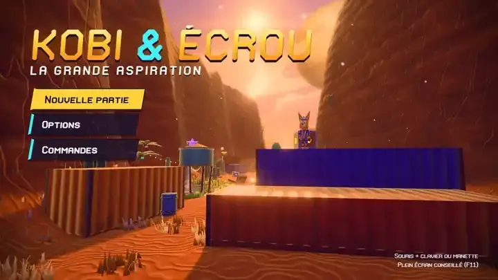

# Kobi & Écrou — La Grande Aspiration

Kobi & Écrou est un jeu d'action-plateforme en 3D jouable dans le navigateur, inspiré de la série Ratchet & Clank.
Kobi, un fennec, et son robot Écrou poursuivent le Baron Vorax, dont l'aspirateur géant engloutit tout sur son
passage, à travers cinq planètes.

Le jeu est réalisé entièrement en code avec Three.js : modèles 3D, textures, ciel, musiques, bruitages et police de
caractères sont générés au lancement, sans aucun fichier d'image, de son ou de modèle.

## Jouer

- **En ligne** : [jouer dans le navigateur](https://maximejacquart.github.io/kobi-et-ecrou/) (Chrome ou Edge conseillés).
- **Fichier téléchargeable** : [télécharger `kobi-et-ecrou.html`](https://github.com/maximejacquart/kobi-et-ecrou/releases/latest),
  puis l'ouvrir d'un double-clic dans Chrome ou Edge. Aucune installation, fonctionne hors connexion.
- **Depuis le code source** : installer [Node.js](https://nodejs.org/) 22 ou plus récent, télécharger le projet
  (**Code** → **Download ZIP** en haut de cette page), décompresser l'archive, ouvrir un terminal dans le dossier obtenu
  et lancer `npm start`.

La progression est sauvegardée dans le navigateur, sur l'ordinateur du joueur.

## Le jeu

- Combat en mouvement
- Arsenal d'armes qui évoluent
- Cinq planètes à explorer
- Plateformes et traversées variées
- Gadgets qui ouvrent de nouveaux passages
- Boss et mode Défi après la fin du jeu

Jouable au clavier et à la souris ou à la manette.

## Avant / après

Les plus grands écarts entre la première version jouable et la version actuelle, à caméra identique : planètes, ennemis et objets du décor.
[Voir la page complète](docs/avant-apres.md).

## Développement

`npm run dev` lance le serveur de développement. Les outils de test et de capture, ainsi que les pages de
développement (visionneuse de Kobi, bestiaire, bacs à effets et à eau), sont décrits dans
[tools/README.md](tools/README.md).

## Mention

Kobi & Écrou est un projet personnel et non officiel, inspiré de la série Ratchet & Clank. Il n'est ni affilié, ni
approuvé, ni soutenu par Sony Interactive Entertainment, Insomniac Games ou les détenteurs des droits de la série.
Ratchet & Clank est une marque de Sony Interactive Entertainment. Les personnages, lieux et noms du jeu sont originaux.

## Licence

Code sous licence [MIT](LICENSE).
