# Avant / après

La première version jouable du jeu et la version actuelle, à caméra identique : à gauche l'avant, à droite aujourd'hui.

## Planètes

**Brikka, Rouille-Ville** : de vraies dunes, une éolienne et des guirlandes à l'entrée de la ville, des nuages dans le ciel.

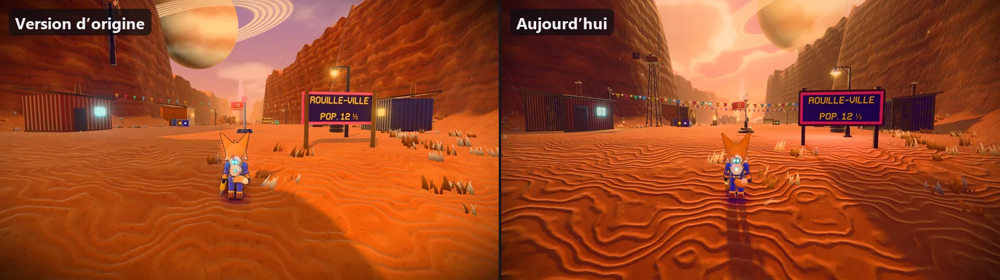

**Nimbara, le départ** : une herbe dense, de gros nuages, et des caisses, un rocher et une cascade en plus.

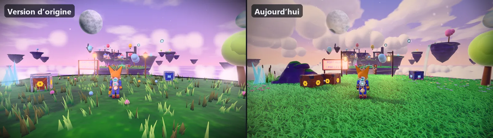

**Givrelune, le hameau** : une aurore dans le ciel, l'igloo et les lampadaires éclairent la neige.

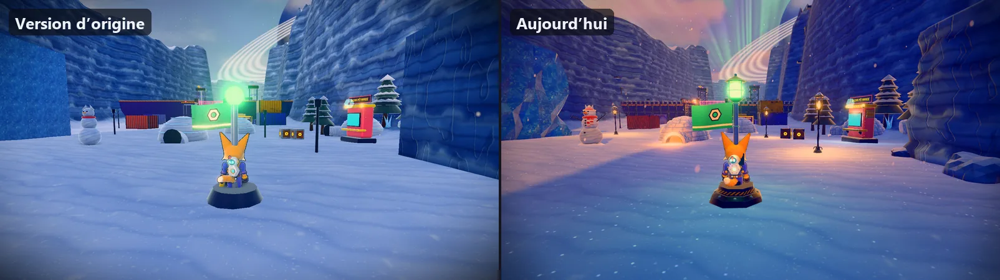

**Givrelune, le lac gelé** : le bassin plat devient un lac gelé, et le bonhomme de neige est habillé.

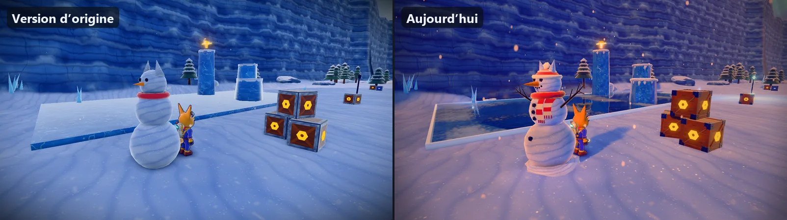

**Luminbois, le village des Lucioles** : une nuit bleutée, une cabane sur pilotis, des champignons lumineux et des guirlandes.

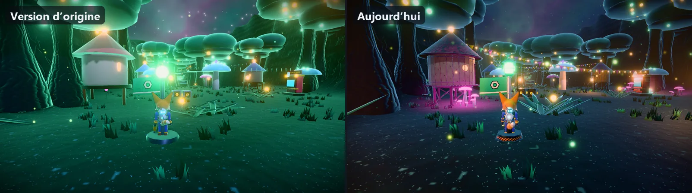

**Station Goinfre, le Bazar Pétarade** : sol réfléchissant, porte éclairée et projecteurs qui balaient le ciel.

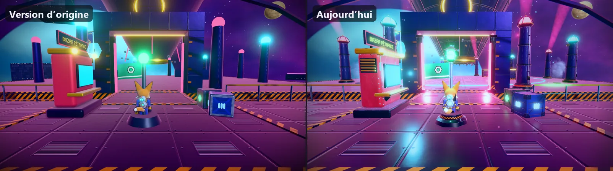

## Ennemis et boss

**Grignoteur** : le petit monstre devient une machine boulonnée, avec un œil-caméra, des crocs d'acier et des pattes articulées.

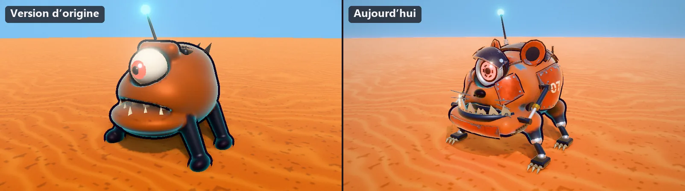

**Pinceur** : une carapace rivetée, des pinces dentelées et des pattes articulées.

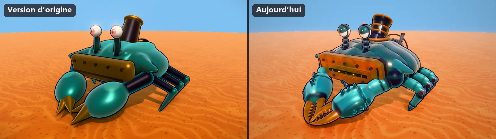

**Fouisseur** : la foreuse lisse devient une taupe mécanique à mèche hélicoïdale, plaques rivetées et griffes.

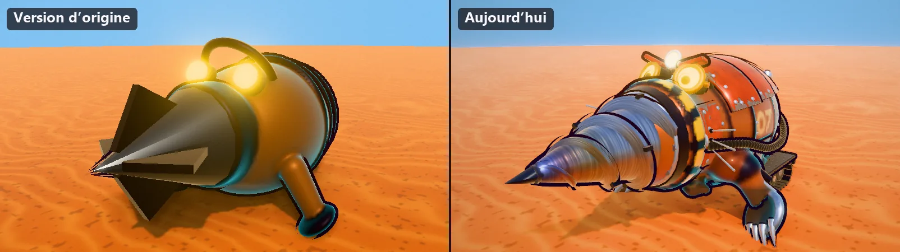

**Champi** : un chapeau à pois, un pied texturé et un socle envahi de racines et de petits champignons.

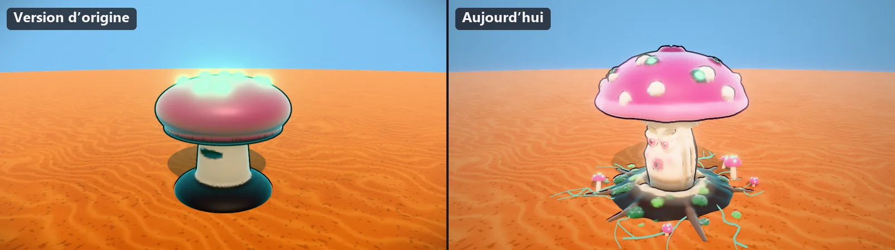

**Mammouth-Foreuse** : une fourrure, une défense-foreuse torsadée, un harnais et une cabine sur le dos.

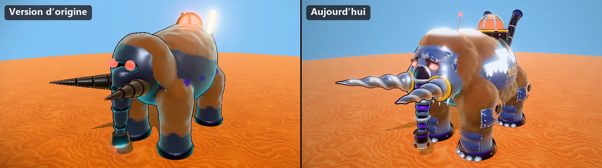

**Baron Vorax, Goinfrotron** : une coque à plaques et hublots, un cockpit sous dôme et des bras blindés.

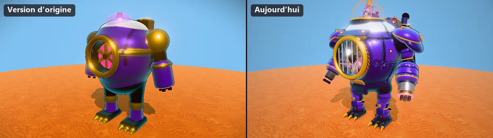

## Armes

**Riveteuse** : un carter laqué écaillé, un barillet de rivets en laiton et un manomètre qui affiche « OUPS ».

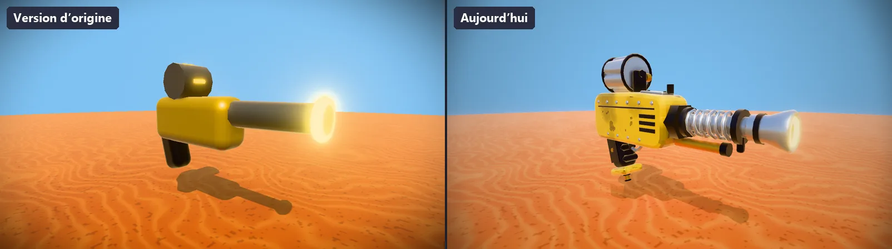

**Zappeur à Chaîne** : un pistolet Tesla, avec un réservoir d'énergie, une bobine de cuivre et des griffes autour de l'émetteur.

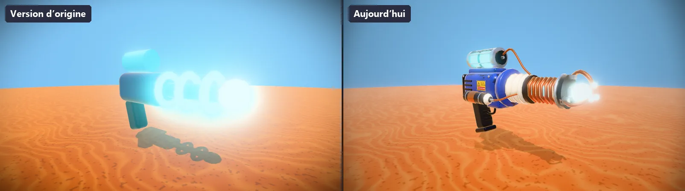

**Canardiseur** : le canard flotte dans une petite baignoire laquée, et le canon se termine en appeau.

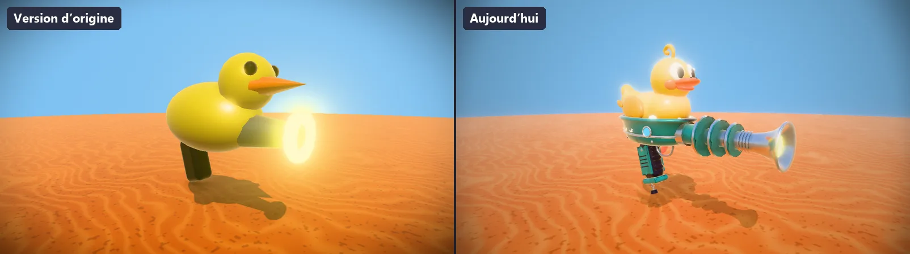

**Bombe-Ressort** : un jouet à remonter, avec un gros ressort chromé dans sa cage et une bombe à mèche allumée.

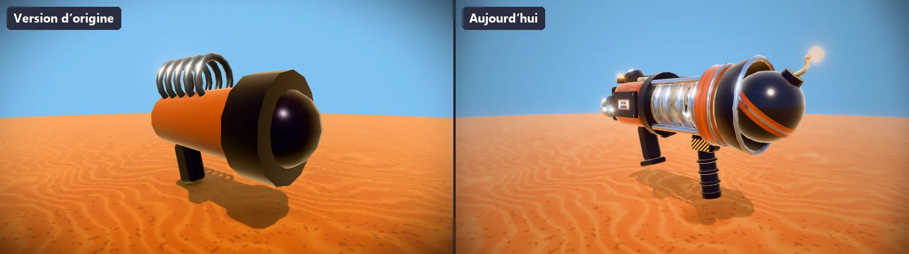

**R.U.I.N.E.** : l'arme ultime, en laque noire et or, avec un barillet de huit roquettes.

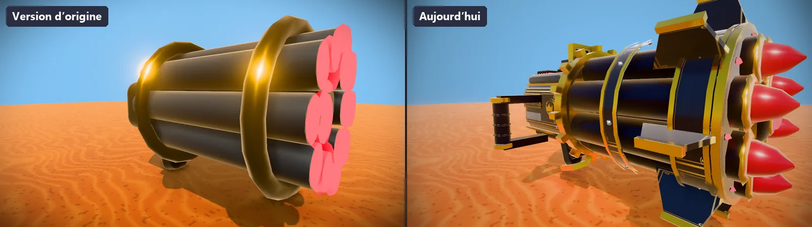

**Tourelle Ronchon** : la tourelle alliée, sur trépied à vérins, avec un œil rouge, des sourcils boulonnés et une moue grincheuse.

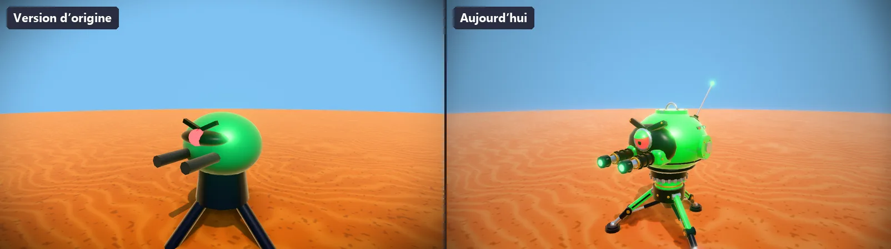

## Objets du décor

**Château d'eau** (Brikka) : une cuve cerclée et rouillée, avec une échelle, sur une charpente croisillonnée.

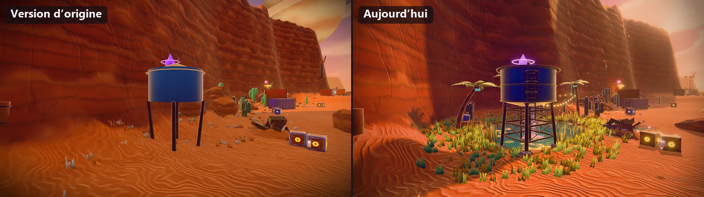

**Canon à nuages** (Nimbara) : le tube rose devient un mortier cerclé sur un affût riveté à volants dorés.

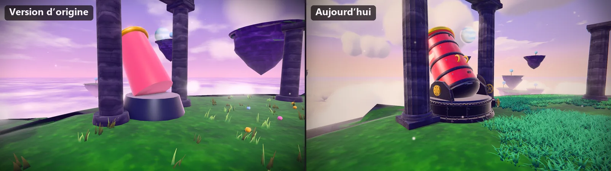

**Montgolfière** (Nimbara) : une enveloppe en fuseaux, un filet de cordes et une nacelle en osier.

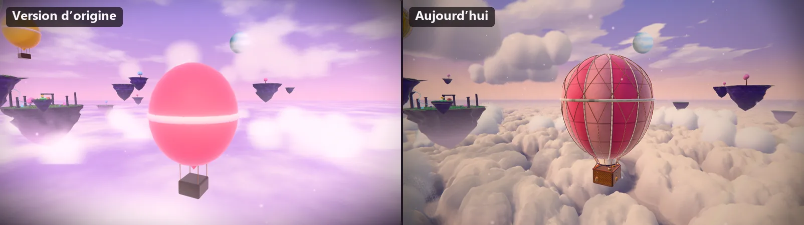

**Igloo** (Givrelune) : des blocs de neige taillés et un tunnel d'entrée maçonné.

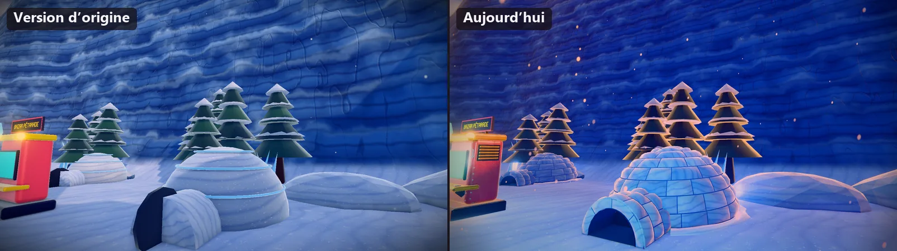

**Plateforme de la canopée** (Luminbois) : un plancher en lattes, un garde-corps de corde et des lanternes.

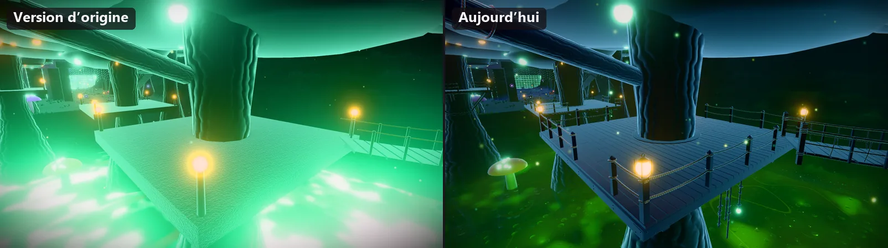

**Méga-Benne** (Station Goinfre) : une coque à panneaux et nervures lumineuses, avec une rangée de hublots.

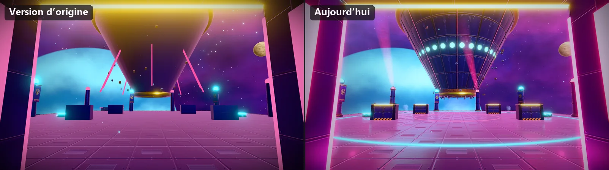
